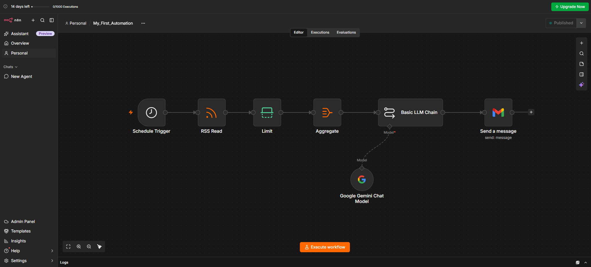

# 🤖 AI News Summarizer & Email Automation with n8n

An n8n workflow that collects AI-related news from RSS feeds, processes the articles, uses Google Gemini through the **Google Gemini Chat Model** connected to a **Basic LLM Chain**, and sends the generated update to Gmail.

## 📌 Project Overview

AI is evolving quickly, and keeping up with new tools and developments can take time. I built this beginner-friendly automation to receive AI-related news updates in my Gmail inbox without manually searching for articles every day.

This is also a hands-on learning project to explore how workflow automation and generative AI can be combined in practical applications.

## 🔄 Workflow Architecture

**Schedule Trigger → RSS Read → Limit → Aggregate → Basic LLM Chain (Google Gemini Chat Model) → Gmail**

> Add your n8n workflow screenshot at `screenshots/workflow.png`, or update the image path above to match the filename you use.

## ⚙️ How It Works

1. **Schedule Trigger** — starts the workflow according to the schedule configured in n8n.
2. **RSS Read** — retrieves articles from the configured RSS feed.
3. **Limit** — restricts the number of items passed to the next node.
4. **Aggregate** — combines the selected article data into a collection for the next step.
5. **Basic LLM Chain** — sends the prepared input to the language-model chain for processing.
6. **Google Gemini Chat Model** — provides the language model used by the Basic LLM Chain to generate AI-powered news summaries.
7. **Gmail — Send a message** — emails the generated output to the configured recipient.

The screenshot shows the nodes executing successfully in the displayed run. The exact results depend on the RSS feed, node configuration, prompt, credentials, and schedule you set up.

## 🧰 Tools & Technologies

| Tool / Node | Role in the project |
|---|---|
| **n8n** | Connects and orchestrates the automation workflow |
| **Schedule Trigger** | Starts the workflow on a schedule |
| **RSS Read** | Collects articles from an RSS feed |
| **Limit** | Controls the number of articles processed |
| **Aggregate** | Combines article data |
| **Basic LLM Chain** | Defines the LLM-processing step |
| **Google Gemini Chat Model** | Supplies the AI model to the LLM chain |
| **Gmail** | Sends the news update by email |

**Gemini integration note:** In the workflow shown, Google Gemini Chat Model is attached to the Basic LLM Chain through its model connection. It is not shown as a standalone Gemini API node. The model's credentials and settings are configured inside n8n.

## 🎯 Project Goals

- Receive AI-related news updates by email.
- Reduce the need to manually search for AI news.
- Learn to connect RSS, an LLM, and Gmail in one workflow.
- Practise passing and organizing data between automation nodes.
- Explore how AI and automation can support everyday work.

## 🚀 Setup Guide

### Prerequisites

- An n8n instance (n8n Cloud or self-hosted).
- An RSS feed URL containing the news you want to follow.
- Google Gemini credentials configured in n8n for the Google Gemini Chat Model.
- Gmail credentials configured in n8n.
- A suitable prompt in the Basic LLM Chain to summarize the supplied article data.

### Steps

1. Create a new workflow in n8n.
2. Add and connect the nodes in this order: Schedule Trigger, RSS Read, Limit, Aggregate, Basic LLM Chain, and Gmail.
3. Add **Google Gemini Chat Model** to the model connector of the Basic LLM Chain.
4. Configure the Schedule Trigger and RSS feed URL.
5. Set the Limit node to the number of articles you want to process.
6. Configure Aggregate to combine the article fields needed by your prompt.
7. Configure the Basic LLM Chain prompt to summarize the supplied AI news. Include article titles, descriptions, dates, and links when those fields are available in your input.
8. Configure the Gmail node with the recipient, subject, and generated message.
9. Test the workflow manually and check the resulting email.
10. Once testing is successful, enable the schedule.

Node labels and available options can vary by n8n version. Adjust the steps to match your workflow configuration.

## 📈 How This Connects to Data Analytics

As an aspiring Data Analyst, I want to understand how AI is changing the data industry and how automation can reduce repetitive work.

This project gives me a practical way to follow developments in areas such as:

- AI tools for data analysis.
- Python and SQL assistance.
- Data preparation and data quality.
- Exploratory Data Analysis (EDA).
- Business intelligence and dashboard reporting.
- Automated reporting and workflow orchestration.

This workflow is a **news collection and summarization project**. It does not itself perform data cleaning, EDA, SQL analysis, or dashboard creation; those are areas I want to explore in future projects.

## 🔐 Credentials & Security

- Never upload API keys, OAuth tokens, passwords, or other secrets to GitHub.
- Store credentials using n8n's credential management.
- Review exported workflow JSON before publishing it.
- Remove personal email addresses and other private information from screenshots and example data.
- Check the exported file for sensitive values before making the repository public.

## 🛠️ Possible Future Improvements

- Add more relevant AI and Data Analytics RSS feeds.
- Categorize news into Generative AI, Data Analytics, Machine Learning, and Data Engineering.
- Include article links and publication dates in the email.
- Add duplicate filtering and better error handling.
- Save selected news articles in a database.
- Build a Power BI dashboard to analyze news topics and trends over time.

## 👨‍💻 About Me

I'm building hands-on projects to grow my skills in **Data Analytics, AI, and Automation**. This is my first n8n automation project, and I plan to keep learning by building and sharing practical projects.

- **LinkedIn:** [Thanda Anil Kumar](https://www.linkedin.com/in/thanda-anil-kumar-5817172a5/)
- **GitHub:** Add your GitHub profile link here.

## ⭐ Feedback

Suggestions for improving this workflow are welcome. If you find the project useful, consider starring the repository.

---

*Built with n8n, RSS feeds, Google Gemini Chat Model, Basic LLM Chain, and Gmail.*
